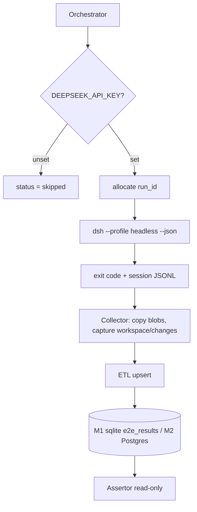

# E2E Artifact Persistence

Feature Name: e2e-artifact-db
Updated: 2026-10-30

## Description

编排器在独立工作区拉起 `dsh --profile headless --json`，采集 Session JSONL、`present` 文件字节和 `workspace/changes` 摘要，写入 M1 SQLite 域或 M2 Postgres，再由独立断言层只读复核。AI 只在“跑测试”侧；入库侧是确定性 ETL。

## Architecture



Webhook 触发无完成回调，且 `@deepseek-ai/dsh-webhook` 为 experimental，M0–M2 不接入。OTel (`FEEDBACK_ONLY`) 不承担回流。

### 回流路径

| 路径 | 介质 | 何时用 |
|------|------|--------|
| A | `dsh-storage-sqlite` 域 `e2e_results` | M1 最小闭环：结构化记录，不含文件本体 |
| B | 离线 ETL → Postgres + blob 存 | M2 终态：产物字节与联查报表 |
| C | 自定义 storage backend | 不选：KV facet 套关系库 |
| D | `dsh-session-telemetry-otel` | 不选：程序化 `emit()` 为 no-op |

A 与 B 可并存：A 管运行内状态，B 管归档。

## Components and Interfaces

| 组件 | 职责 | 生命周期 |
|------|------|----------|
| Orchestrator | 分配 `run_id`、准备工作区、exec dsh、解释退出码 | 每次 run 一个进程 |
| Headless runner | 官方执行面；stdout NDJSON；stderr 仅 `dsh:` 诊断 | 一任务一进程，无常驻端口 |
| Collector | 按 `deliverables/presented` 复制字节；dispose 前读 `workspaceChanges.summary` | 紧随 dsh 退出，同一工作区仍在 |
| ETL | 解析 JSONL、脱敏、upsert | 单写者 |
| Blob store | `blobs/sha256/ab/<digest>` | 内容寻址，按 digest 去重 |
| Assertor | 独立只读连接 + 重新哈希 | 与 writer 分进程、分角色 |
| Host plugin（M1） | `defineDomain` + `ctx.storageDomain.open` | `ctx.effect` 持有 handle，卸载时 `close()` |

公共 TypeScript 与 HTTP 面见 [api.md](api.md)。库表见 [schema.md](schema.md)。

### dsh 组合（M1 patch，不动 shipped 默认）

```yaml
- name: '@deepseek-ai/dsh-storage'
- name: '@deepseek-ai/dsh-storage-sqlite'
  config:
    path: /var/lib/dsh/e2e-results.db
    journalMode: wal
- name: '@deepseek-ai/dsh-storage-domain'
  config:
    backend: sqlite
    routes:
      e2e_results: sqlite
```

网络盘将 `journalMode` 设为 `delete`、`truncate` 或 `persist`。`:memory:` 退出即消失，跨进程断言不可用。

### JSONL 定位

ETL 用 `generationLogPath(root, cwd, sessionId, 4, compression)` 定位当前代，禁止手写 `root/<uuid>/...`。回流解析建议 `compression: 'none'`。Writer 为 `SESSION_FORMAT_VERSION = 4`。

### Headless 完成信号

- 退出 0：owned interval 内最终 `turn/end` 为 `completed`。
- 退出 1：aborted、error、无 turn、或启动失败。
- `--json` 流格式完好仍可能描述失败运行；终判看退出码与 `turn/end.reason.kind`。
- 未知 `--session-id` 在任务开始前失败。

SDK `RunResult.finalResponse` 是区间内最后一条已提交 assistant 文本，steering 可能混入，不作通过依据。

## Data Models

见 [schema.md](schema.md)。要点：

- 幂等键是 `run_id`，不是 `session_id`。
- `e2e_artifact` 按 `(run_id, path)` upsert；`digest` 区分内容版本。
- 路径 A 每表一行 JSON 文档，物理表 `u_e2e_results_<table>(key TEXT PRIMARY KEY, value TEXT)`。
- 域名 `e2e_results` 满足 `UNIT_NAME_RE`。

## Correctness Properties

1. 声明不等于归档：库中有 `e2e_artifact` 行当且仅当 blob 字节已 durably 写入且 digest 匹配。
2. 写入先 durably 再 resolve：storage-domain `put` 在 backend 确认后才更新内存。
3. 断言连接与写入连接分离。
4. `workspace/changes` 摘要要么在 dispose 前采集，要么标记 `changes_unavailable`。
5. 同一 sqlite 文件同一时刻只有一个写者。
6. 模型不可见：Host 存储不注册 tool、不注入 prompt、不追加 Session 事件。
7. 重试分配新 `run_id`；续跑对话复用 `session_id` 仍插入新 run 行。

## Error Handling

错误码与所有权见 [errors.md](errors.md)。原则：

- 启动前失败 → `aborted`，不写 artifact。
- 单文件复制失败 → 该路径 `artifact_copy_missing`，run `failed`。
- sqlite 写锁争抢 → 立即 `storage_busy`，不 busy-wait。
- 域版本不符 → `version-mismatch`，拒绝打开。
- 断言失败 → 保持已写入行，status `failed`，由调用方决定是否新 `run_id` 重试。

## Test Strategy

| 层 | 覆盖 | 入口 |
|----|------|------|
| 解析器单元 | JSONL `deliverables/presented`、JUnit/vitest/pytest 报告 | 源码面 vitest |
| Collector | 缺失文件、符号链接、子代理声明不自动上挂父会话 | 临时工作区 |
| M1 集成 | Host 插件写入后另开只读连接能读到；同 `run_id` upsert | Loader 启动真实 cordis patch |
| M2 集成 | digest 与 blob 一致；未触碰基线逐字节相同 | 独立 Postgres |
| 快照 | 任务 prompt 与 “必须 present” 指令的模型可见文本 | `pnpm run test:snapshot` |
| with-key | 每日/发版冒烟；无 key self-skip | `pnpm dsh --profile headless` |

断言验证外部状态（库行、文件字节、退出码），不检查最终回答关键词。

## References

- `packages/deliverables/tool-present/README.md` — present 只记路径
- `packages/deliverables/workspace-changes/README.md` — 摘要出进程即失效
- `packages/storage/storage-domain/README.md` — `defineDomain` / `UNIT_NAME_RE`
- `packages/storage/storage-sqlite/README.md` — 单写者、无迁移
- `packages/session/session-persistence-jsonl/README.md` — 磁盘布局
- `packages/bundle/headless/README.md` — 退出码与 `--json`
- `packages/sdk/client/src/types.ts` — `RunResult`
- `packages/core/session/src/types.ts` — `SESSION_FORMAT_VERSION = 4`，`TurnEndReasonMap`
- `docs/testing.md` — 验证世界、with-key
- `docs/architecture.md` — application-launch
