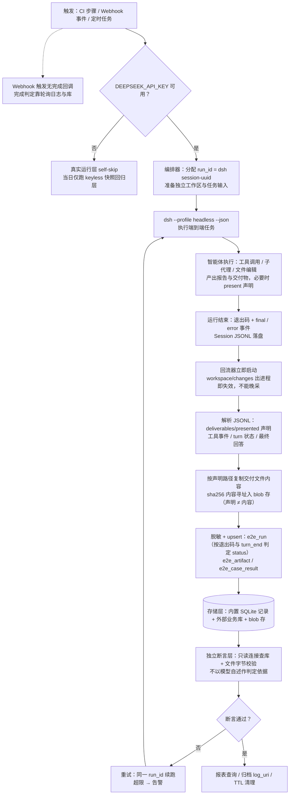

# 基于 Harness 的端到端测试与产物回流方案

> 状态：方案草案。本文规划"用 DeepSeek Harness（dsh）驱动端到端测试任务，并把测试产物回流到数据库"的整体架构、选型、数据模型、断言策略与实施阶段。实施前建议按 [.agents/notes/README.md](.agents/notes/README.md) 的规则将本文沉淀为 `proposed/testing` Agent Note。

## 0. 范围与假设

- "端到端测试"指：由 dsh 智能体在真实工作目录中执行一个完整任务（跑测试、生成报告、产出文件），运行结果与该任务的全部产物被视为待回流的数据，而不是 dsh 自身的单元/快照测试套件。仓库自身的测试分层见 [docs/testing.md](docs/testing.md)，与本方案互补。
- "某些数据库"尚未定死。本方案同时覆盖两种落点：harness 内置存储（`dsh-storage` 家族，SQLite 单文件或 JSON 目录），以及外部业务数据库（Postgres/MySQL 等，经回流器 ETL 写入）。第 5 节给出决策矩阵。
- 关键事实先行声明：`present` 工具只在 Session 日志记录文件路径与描述，**不复制文件内容**；Session ZIP 导出同样"只含声明，不含文件内容"（[packages/deliverables/tool-present/README.md](packages/deliverables/tool-present/README.md)）。因此"产物内容进数据库"必须由回流器自己完成，harness 没有现成的内容入库通道。
- 运行 dsh 一律走 `dsh --profile <name>`，不自造入口 bin（[应用启动规则](docs/architecture.md#application-launch)）。

## 1. 需要先拍板的决策问题

| # | 问题 | 选项 | 影响 |
|---|---|---|---|
| D1 | 目标数据库是什么 | 内置 `dsh-storage-sqlite` / `storage-json`；外部 Postgres/MySQL；对象存储放文件 + 关系库存元数据 | 决定第 5 节路径 A/B/C 的取舍 |
| D2 | "产物"的边界 | 仅 `present` 交付文件；含 `workspace/changes` 变更清单；含 Session JSONL 全量事件流；含最终回答文本 | 决定回流器解析面与存储量 |
| D3 | 触发方式 | CI 步骤（一次性 headless）；程序化编排（SDK stdio）；外部事件（Webhook）；定时 | 决定同步/异步与完成信号获取方式 |
| D4 | 是否花真 key | 每轮真模型运行，或仅回归用无 key 快照回放 + 每日冒烟真跑 | 决定成本与"是否证明智能体真的有效"（testing.md 的 with-key 立场） |
| D5 | 保留与脱敏策略 | Session JSONL 含全部 prompt/输出；入库前是否脱敏、保留多久 | 决定回流器清洗阶段 |

## 2. 总体架构

```
触发层              执行层（dsh）                产物层                        回流层                  存储/断言层
─────────         ────────────────           ──────────────────           ─────────────────         ─────────────
CI / 编排脚本  ──▶  dsh --profile headless  ──▶  deliverables/presented  ──▶  回流器（ETL）      ──▶  内置 SQLite/JSON
Webhook 事件       dsh --profile sdk            workspace/changes            · 解析 Session JSONL      或外部 DB
定时任务           (M3: dsh --profile acp)      最终回答 / 退出码              · 复制交付文件内容        （Postgres/MySQL）
               ◀──  状态回传：exit 0/1     ◀──   session-<uuid>.jsonl 落盘    · upsert 元数据          断言层直接查库/查文件
```

五个环节各自有确定的 harness 依托：

- 触发与执行：headless / sdk / acp / webhook，见第 3 节。
- 产物识别：`deliverables/presented`、`workspace/changes`、JSONL 日志、`--json` 事件流，见第 4 节。
- 回流：路径 A（进程内 `ctx.storageDomain`）、路径 B（离线 ETL 进外部库）、路径 C（自定义 backend），见第 5 节。
- 数据模型：见第 6 节。
- 断言：独立连接查库 + 字节校验，遵循"验证世界，而不是验证自我汇报"（testing.md），见第 7 节。

## 2.1 端到端业务流程图



图中三处硬约束的出处：回流必须"立即启动"（`workspace/changes` 摘要出进程即失效，[workspace-changes README](packages/deliverables/workspace-changes/README.md)）；"复制内容"是回流器自建步骤（`present` 只记路径不复制，[tool-present README](packages/deliverables/tool-present/README.md)）；"self-skip"与"独立断言"来自 [docs/testing.md](docs/testing.md) 的 with-key 立场与"验证世界"规则。

## 3. 环节一：触发与执行

### 3.1 四种入口对比

| 入口 | 命令/接口 | 适用 | 完成信号 | 约束 |
|---|---|---|---|---|
| headless 一次性 | `pnpm dsh --profile headless "task"`；`--json` 输出 NDJSON 事件流；`--session-id` 续跑 | CI 步骤、批处理脚本 | 进程退出码（0 完成 / 1 中止或出错）+ `final` 事件 | 一次调用一个任务，无交互追问（[headless README](packages/bundle/headless/README.md)） |
| SDK 程序化 | TypeScript/Python 客户端拉起 `dsh --profile sdk`，stdio JSON-RPC；`run()` 返回 `{ sessionId, finalResponse, events, notifications }`（[sdk/client README](packages/sdk/client/README.md)） | 编排器需要多轮、并发、订阅事件 | 每个 activity interval 到 `idle` 为止；`close()` 收尸进程 | `finalResponse` 是对话间隔内最后一条已提交 assistant 文本，不等于因果回答；steering 可能混入 |
| Webhook 事件驱动 | `ctx.webhookRuntime.register(rule)`，规则返回 `WebhookSessionRequest{workspacePath,title,prompt,agentPreset,permissionPreset}`（[webhook README](packages/webhook/webhook/README.md)） | 外部事件（PR、告警）触发测试任务 | **无完成回调**——`followup()` 成功即提交点，之后不报告进度或结果 | 进程内 fire-and-forget，崩溃丢未提交调用；无去重；只能配合轮询日志/库做完成判定 |
| ACP 自动化协议 | `dsh --profile acp`（[acp-app](packages/bundle/acp-app/README.md)） | 第三方自动化客户端的标准协议面 | 协议内会话状态 | 本方案非必需，列为 M3 备选 |

### 3.2 建议默认

- M0–M1 用 **headless `--json`**：最简单，退出码即粗粒度结果，`session` 起始事件给出的 `session-<uuid>` 天然可作 run_id（幂等键）。
- 需要多轮注入、实时事件订阅时升级为 **SDK 客户端**。
- 无论哪种：`DEEPSEEK_API_KEY` 从根 `.env` / 环境读取（[AGENTS.md](AGENTS.md) Secrets 节），无 key 的 CI 按 testing.md 惯例让真实运行套件 **self-skip**，用 keyless 快照回放层承担回归（[dsh-session-snapshot](packages/test-support/session-snapshot/README.md)）。

## 4. 环节二：产物定义与识别

产物分四类，回流器按 D2 决策取子集：

1. **交付文件**：智能体调用 `present` 声明的最终文件。Session 日志记 `deliverables/presented` 事件（路径 + 可选描述）。注意三点：声明不复制内容；后续编辑会改变"打开到的"文件（声明是活路径，不是版本）；父会话必须自己调用 `present`，子代理产的文件不会自动挂到父会话声明上（tool-present README）。→ **回流器必须自己按路径读取并复制内容**。
2. **工作区变更**：`workspace/changes` 事件按 turn 记录变更文件清单与行数（[workspace-changes README](packages/deliverables/workspace-changes/README.md)）。摘要与 diff 只在本 Host 进程存活期间可查，Session dispose 即失效，重启后旧 turn 无卡。→ 回流器要在运行结束后**当场采集**，或外部重跑 `git diff` 兜底（该插件本身对 git 仓库只读，不污染工作树）。
3. **全量过程**：Session JSONL 日志，每会话一个追加式文件，默认 Zstandard 帧压缩；组合里配 `compression: 'none'` 即为逐行可读 UTF-8（[session-persistence-jsonl README](packages/session/session-persistence-jsonl/README.md)）。文件名遵循 `session[.vN].jsonl` writer format（[docs/session-format-status.md](docs/session-format-status.md)）。→ 它是回流的**唯一无损事实源**：交付声明、工具调用、turn 状态、最终回答都在里面。
4. **粗粒度结果**：退出码 + `--json` 流的 `final`/`error` 事件 + `turn_end` 失败原因（`--json` 模式下格式完好的流也可能描述失败运行，终判信号是退出码与 `turn_end` reason，headless README）。

## 5. 环节三：回流路径选型（决策矩阵）

### 路径 A：进程内 `dsh-storage` 家族（推荐起步）

在 profile 组合层（bundle patch 或 out-of-tree bundle：`dsh plugin --profile <name> add <pkg>`，不动 shipped 默认）挂载三件套，自定义 Host 插件用 `ctx.storageDomain` 写类型化记录：

```yaml
- name: '@deepseek-ai/dsh-storage'
- name: '@deepseek-ai/dsh-storage-sqlite'
  config:
    path: <绝对路径>/e2e-results.db     # 或 :memory:（进程退出即消失，跨进程断言不可用）
    journalMode: wal                    # 网络盘改用 delete/truncate/persist
- name: '@deepseek-ai/dsh-storage-domain'
  config:
    backend: sqlite
    routes:
      e2e-results: sqlite
```

```ts
const e2eSpec = defineDomain({
  name: 'e2e-results',
  version: 1,
  tables: {
    runs: domainTable(runRecordSchema),        // zod 校验；每次写先落盘再 resolve
    artifacts: domainTable(artifactRecordSchema),
  },
});
const domain = await ctx.storageDomain.open(e2eSpec);
await domain.table('runs').put(runId, { status: 'passed', logPath, startedAt, finishedAt });
```

语义与限制（[storage README](packages/storage/storage/README.md)、[storage-sqlite README](packages/storage/storage-sqlite/README.md)、[storage-domain README](packages/storage/storage-domain/README.md)、[后端契约](packages/storage/storage/src/backend.ts)）：

- 物理布局是 document-per-row：每 unit 表为 STRICT 表 `u_<unit>_<table>(key TEXT PRIMARY KEY, value TEXT)`，值列存记录 JSON。够用，但不是关系模型——复杂联查、聚合报表需求直接指向路径 B。
- 写为单语句原子、按域串行化；**无 busy-wait/重试**，跨进程争抢写锁立即失败 → 同一 DB 文件只允许单写者；CI 并发要么按 run 分文件、跑完合并，要么把入库挪到运行后的单进程阶段（路径 B）。
- 无迁移：`user_version` 或 unit 版本不符直接 `version-mismatch` 拒绝 → 演进靠新 domain 名或外部迁移脚本。
- 文件/目录以 owner-only（0600/0700）创建；Host 侧能力，模型完全不可见，不进 Session 事件流。
- 断言连接：测试编排器另开一个 `node:sqlite` 只读连接查 `e2e-results.db`，与写入方进程分离，满足"独立复核"。

### 路径 B：离线回流器 → 外部业务库（推荐终态）

运行结束后，独立 ETL 进程按 D2 采集，写入 Postgres/MySQL 等：

```
etl(run):
  1. 定位日志    root/<session-uuid>/session.vN.jsonl（jsonl backend 的 root 配置）
  2. 逐行解析    事件信封字段以 docs/session-format-status.md 为准：
                 取 deliverables/presented → 文件清单
                 取工具结果 / turn 状态     → 每步执行明细
  3. 复制内容    按路径从工作区读文件 → sha256 内容寻址入 blob 库（本地目录或对象存储）
  4. 写元数据    upsert 到关系库（DDL 见第 6 节），run_id=session id → 天然幂等
  5. 采集变更    运行结束当场取 workspace/changes；否则外部重跑 git diff 兜底
```

适用：产物文件本体、跨 run 报表、团队共享查询。harness 不内置 Postgres/MySQL 连接器，连接器属于回流器自己的代码——这是刻意的分工：存储家族管"记录进媒体"，业务库 schema 归业务所有。

### 路径 C：自定义 storage backend 直连外部库

实现 `kv` facet 契约把任意外部库注册成 backend（共享 conformance suite 校验，`tests/contract.ts`）。**不推荐首选**：契约只有 KV 形态、命名受 `UNIT_NAME_RE` 限制、无迁移、`kv` 是唯一 facet（`log` facet 尚在 session-backend 迁移提案中），为外部关系库套 KV 接口是把简单事情复杂化。仅当"记录必须经 ctx.storageDomain 统一面写入且媒体必须外部"同时成立时评估。

### 路径 D：OTel telemetry —— 只做观测，不做回流通道

`dsh-session-telemetry-otel` 默认 `FEEDBACK_ONLY`：只有用户显式反馈才放行前缀记录，程序化 `emit()` 恒为 no-op（[README](packages/session/session-telemetry-otel/README.md)）。它的设计目标是用户授权下的记录外送，自动化测试回流不应依赖或绕过它——绕过策略门禁正是该包明确拒绝的行为。运行指标如需外送，放在回流器自己的埋点里。

### 决策矩阵

| 维度 | A 进程内 storage-sqlite | B 离线 ETL → 外部库 | C 自定义 backend | D OTel |
|---|---|---|---|---|
| 新增代码量 | 小（一个 Host 插件 + 域定义） | 中（解析 + 复制 + 连接器） | 大（契约 + conformance） | 无（但不可用） |
| 关系查询/报表 | 弱（document-per-row） | 强 | 中 | 无 |
| 多进程并发写 | 单写者约束 | 运行后集中入库，无争抢 | 取决于外部库 | — |
| 文件内容本体 | 否（只进记录） | **是**（blob 复制） | 否 | 否 |
| 与 harness 版本耦合 | 后端契约/无迁移 | 仅耦合日志 writer format（有版本规则管着） | 契约全量 | 策略面 |
| 建议 | **M1 先落**：结构化结果与状态 | **M2 终态**：产物文件 + 业务库 | 不选 | 不选 |

A 与 B 不互斥：A 管运行内状态（进度、幂等、断线续跑判定），B 管运行后归档与共享查询。

## 6. 数据模型建议（外部库版）

```sql
CREATE TABLE e2e_run (                       -- 一次端到端运行
  run_id       text PRIMARY KEY,             -- dsh session id（session-<uuid> 或显式 --session-id）
  profile      text NOT NULL,                -- headless | sdk | webhook 规则 id
  task_ref     text NOT NULL,                -- 任务文本的引用（脱敏后全文或 hash+摘要）
  exit_code    integer NOT NULL,
  status       text NOT NULL CHECK (status IN ('passed','failed','aborted')),
  started_at   timestamptz NOT NULL,
  finished_at  timestamptz,
  log_uri      text NOT NULL,                -- Session JSONL 归档位置（无损事实源）
  meta         jsonb
);

CREATE TABLE e2e_artifact (                  -- present 声明的交付文件（内容已复制）
  run_id       text NOT NULL REFERENCES e2e_run,
  path         text NOT NULL,                -- 声明时的路径（相对工作区或绝对）
  digest       text NOT NULL,                -- sha256；内容寻址
  blob_uri     text NOT NULL,                -- 复制后的存放位置
  description  text,
  copied_at    timestamptz NOT NULL,
  PRIMARY KEY (run_id, path)
);

CREATE TABLE e2e_case_result (               -- 任务内逐个断言点（由被测产物解析而来）
  run_id       text NOT NULL REFERENCES e2e_run,
  case_id      text NOT NULL,                -- 用例标识（来自测试报告解析）
  outcome      text NOT NULL,                -- passed | failed | skipped
  detail       jsonb,                        -- 时长、错误、行号等
  PRIMARY KEY (run_id, case_id)
);
```

要点：

- **run_id 用 Session id**：headless 默认 `session-<uuid>`、`--session-id` 可显式复用，重跑同 id 即续同一对话；upsert 以 (run_id) / (run_id, path) 为幂等键。
- 交付路径是活引用，同一 path 在不同 run 是两个记录；用 digest 区分内容版本。
- 内置 A 路径下的对应结构：`e2e-results` 域、`runs`/`artifacts` 两表、key 同上，值为整条 JSON 记录。
- Schema 演进：外部库走自己的 migration 工具；内置域靠 version 字段 + 新域名切换（无自动迁移）。

## 7. 校验与断言策略

遵循 [docs/testing.md](docs/testing.md) 三条既有立场，落到本场景：

1. **验证世界，不验证自我汇报**：判定通过与否不靠关键词检查最终回答，而是——
   - 用独立连接查库：`e2e_run.status`、`e2e_case_result` 行数与 outcome 分布；
   - 文件字节校验：从 blob 存重取文件与期望基线比对，或对产物声明"未触碰的文件逐字节相同"；
   - 过程校验：解析 Session JSONL，断言关键工具事件存在、`turn_end` reason 正常、退出码为 0。
2. **真实实现优先于 mock**：执行层就是发货的 `dsh` profile（发布产物面用 built `lib/` 入口，源码面用 `pnpm dsh`），只 mock 外部不可控服务；被测业务系统按环境配置真连。
3. **分层成本**：
   - keyless 快照回放层：智能体行为的回归防线，无 key、确定性、CI 必跑；
   - with-key 真实运行层：只有它"证明智能体对真实模型有效"（testing.md with-key 立场），无 `DEEPSEEK_API_KEY` 时整层 self-skip，建议每日/发版节奏而非每 PR。
4. 对模型随机性：断言**结构化字段与产物存在性/digest**，断言文本存在不断言措辞；需要稳定文本时把期望放进被测侧而非回放侧。

## 8. CI 与运行治理

- **资源所有权**：每个 spec 自建的 DB 文件、工作区目录、临时端口在 `afterEach` 由创建方 dispose；并发 worker 下 sqlite 无写锁重试 → DB 文件路径带 worker/run 后缀或统一延后入库。规则细目见 [dsh-ci-test-reliability](.agents/skills/dsh-ci-test-reliability/SKILL.md)。
- **进程生命周期**：headless 每调用一进程、无常驻端口，天然适配 CI；SDK 路径必须 `close()`/`await using` 收尸子进程。
- **密钥与配置**：根 `.env` 提供 `DEEPSEEK_API_KEY`（可选 `DEEPSEEK_BASE_URL`），绝不提交；profile 差异走 cordis.yml / patch 的显式 `Config` 字段，不在代码里硬编码可调值（AGENTS.md 约定）。
- **Windows 注意**：跨机/网络盘共享 sqlite 时 WAL 共享内存文件不可用，改 `journalMode: delete|truncate|persist`；CI 平台矩阵由仓库自有信号管辖，本地不代跑。
- **保留策略**：JSONL 全量事件流含 prompt 与工具输出，入库/归档前按 D5 做脱敏与 TTL；blob 库存交付文件内容，按 digest 去重。

## 9. 实施阶段与验收标准

| 阶段 | 交付 | 验收标准 |
|---|---|---|
| M0 手动贯通 | 一条 `pnpm dsh --profile headless --json "<任务>"` 跑通；确认 JSONL 落盘路径、`deliverables/presented` 事件可解析 | 退出码、`session`/`final` 事件、日志文件三者对得上；无需数据库 |
| M1 回流最小闭环 | 路径 A：profile 组合挂 storage+sqlite+domain，Host 插件写 `runs` 记录；编排器独立只读连接断言 | 同机重开连接能查到本次 run 记录；重跑同 run_id 为 upsert 非重复行 |
| M2 产物入库 + 外部库 | 路径 B：ETL 解析 JSONL → 复制交付文件入 blob 存 → upsert 元数据到 Postgres/MySQL；`workspace/changes` 运行结束当场采集 | 库中 artifact 行与磁盘 blob 文件 digest 一致；未触碰文件逐字节相同；断言层全程不读模型自述 |
| M3 规模化 | SDK 编排多场景并发、Webhook 事件触发接入、keyless 快照回归层 + with-key 冒烟层双轨进 CI、报表查询 | 无 key CI 全绿（真实层 self-skip）；有 key 冒烟稳定产出入库记录；单 run 失败不阻塞其它 run |

## 10. 风险与对策

| 风险 | 事实依据 | 对策 |
|---|---|---|
| `present` 不复制内容，"入库产物"会被误当成已归档 | tool-present README：只记路径；ZIP 导出同样只含声明 | 回流器自管内容复制与 digest；把"声明 ≠ 归档"写进团队约定 |
| `workspace/changes` 出进程即失效 | workspace-changes README：摘要驻留 Host，dispose 后不可查 | 运行结束事件钩子内立即采集；或外部 `git diff` 兜底 |
| sqlite 跨进程写争抢立即失败 | storage-sqlite README：无 busy-wait/retry | 单写者（运行后集中入库）或分文件合并 |
| 无迁移，版本不符拒绝打开 | 同上 + storage 后端契约：`version-mismatch` | 演进用新域名/外部库自己的 migration；CI 清库重建 |
| Webhook 无完成信号 | webhook README 已知限制：fire-and-forget、无 completion result | 需要完成判定的场景改用 headless/SDK 同步等待，或轮询入库结果 |
| OTel 通道被误用为回流 | session-telemetry-otel：`FEEDBACK_ONLY` 门禁、程序化 emit 是 no-op | 回流一律走 A/B；OTel 仅部署侧观测 |
| 模型措辞波动导致断言脆弱 | testing.md"验证世界"立场 | 只断言结构化结果、文件 digest、事件存在性 |
| JSONL 含敏感内容入库扩散 | 日志无损记录全部 prompt/工具输出 | D5 脱敏阶段前置于入库；blob 与库分权限 |
| 真实模型成本 | with-key 立场：回归可 keyless，真实有效性只有 with-key 能证明 | 双轨分层（第 7 节第 3 条） |

## 11. 三项确认（已定结论）

### 11.1 产物格式：JSON 入库契约，不为回流发明新格式

| 产物 | 格式 | 依据 |
|---|---|---|
| 入库记录（run / artifact / case） | JSON 结构化记录，schema 先行：路径 A 用 zod（`defineDomain` 逐条校验），路径 B 用 DDL（第 6 节） | storage-domain README：每条记录写入前按 schema 校验 |
| 过程事实源 | Session JSONL，沿用 harness writer format，不自定义：`SESSION_FORMAT_VERSION = 4`（[packages/core/session/src/types.ts](packages/core/session/src/types.ts)），文件名 `session[.vN].jsonl`；回流解析用 `compression: 'none'` 即逐行 UTF-8 | [docs/session-format-status.md](docs/session-format-status.md)、session-persistence-jsonl README |
| 用例级明细 | 被测测试运行器自己的标准机器可读输出（JUnit XML / vitest JSON / pytest JSON 等），由回流器解析进 `e2e_case_result` | 断言"验证世界"：结构化结果来自测试运行器，不来自模型自然语言回答 |
| 交付物本体 | 任意格式文件（HTML/MD/PDF 报告、PNG/JPEG 截图、xlsx 等），sha256 内容寻址入 blob 存；数据库只存 `(path, digest, blob_uri)` | present 只声明路径；内容复制是回流器职责 |

**红线：自然语言最终回答不是回流格式。** `finalResponse` 只入库做参考，通过判定一律来自上面四类。

### 11.2 存储地方：三段分置

| 数据 | 落点 | 说明 |
|---|---|---|
| Session JSONL 全量 | `dsh-session-persistence-jsonl` 的 `root`（必填配置）指向集中卷/统一归档目录 | 运行内唯一无损事实源；归档后库中只存 `log_uri` |
| 结构化记录 | M1：内置 `dsh-storage-sqlite`（单文件 `e2e-results.db`）；终态：外部业务库（Postgres/MySQL），经路径 B ETL | 内置侧约束：document-per-row KV、单写者（无写锁重试）、无迁移（版本不符拒绝打开）；复杂联查、多消费方直接走外部库 |
| 交付物文件内容 | blob 存（本地内容寻址目录或对象存储），不进数据库行 | 与 session-log-export 附件布局 `files/<digest>/<name>` 同思路 |

### 11.3 AI 能力植入：四层各管一件事，按优先级用

| 层 | 在本方案中的角色 | 植入点与依据 |
|---|---|---|
| 大模型 | 执行引擎本身。AI 在"跑测试"侧，不在"入库"侧 | 模型路由在启动时固定：SDK `initialize` 携带 provider/model 路线、webhook `WebhookSessionRequest.model` 可显式命名、headless 用部署默认；key 走 `DEEPSEEK_API_KEY`（AGENTS.md） |
| 提示词 | **测试用例的第一载体**。任务 prompt = 用例：环境说明、步骤、期望产物、"完成后必须 present" 的交付指令 | 版本化 prompt 库管理；遵守 Model-visible ⟺ logged 约定——进模型请求的内容必可从 Session 日志复原（AGENTS.md Conventions） |
| Skill | **操作规程载体**："本仓库怎么跑 E2E、报告怎么写成 JUnit/JSON、产物如何 present" 写成 skill，而非塞长 prompt | [skill 家族](packages/skill/README.md)：`skill-filesystem` 从项目目录发现、`tool-skill` 提供模型装载面、`skill-office` 自带 Word/PPT/Excel 工作流（Office 报表场景直接复用） |
| MCP | **仅用于接入既有外部系统**（测试环境控制、设备农场、现存业务库的 MCP server） | [mcp 家族](packages/mcp/README.md)：只配 `mcp-client` 条目；shipped profile 已挂 `mcp-resources`。内置 shell/browser-use/computer-use/lsp 已覆盖绝大多数端到端操作面，**不为了 AI 而加 MCP** |

长期能力（如"结果直接写业务库"的工具）走 documented extension points 写成插件/自定义 tool，不改 agent-loop（AGENTS.md 约定），并同步设计其 UI 呈现与 snapshot 覆盖。

植入优先级：**Prompt（用例）+ 内置工具 → Skill（规程）→ MCP（外部系统）→ 自定义插件（长期能力）**。

## 12. 参考

- [docs/testing.md](docs/testing.md) — 测试分层、with-key 政策、"验证世界"、真实入口路径规则
- [docs/architecture.md](docs/architecture.md#application-launch) — 应用启动规则
- [packages/bundle/headless/README.md](packages/bundle/headless/README.md) — 一次性任务、`--json`、`--session-id`、退出码
- [packages/sdk/client/README.md](packages/sdk/client/README.md) — 程序化驱动与 `RunResult`
- [packages/deliverables/tool-present/README.md](packages/deliverables/tool-present/README.md) / [packages/deliverables/workspace-changes/README.md](packages/deliverables/workspace-changes/README.md) — 两类产物事件
- [packages/storage/README.md 家族](packages/storage/storage/README.md)（hub / sqlite / json / domain）— 内置存储与后端契约
- [packages/session/session-persistence-jsonl/README.md](packages/session/session-persistence-jsonl/README.md) / [docs/session-format-status.md](docs/session-format-status.md) — 无损事实源与 writer format
- [packages/webhook/webhook/README.md](packages/webhook/webhook/README.md) — 事件驱动触发与其限制
- [packages/session/session-telemetry-otel/README.md](packages/session/session-telemetry-otel/README.md) — 为什么它不承担回流
- [.agents/skills/dsh-ci-test-reliability/SKILL.md](.agents/skills/dsh-ci-test-reliability/SKILL.md) — CI 并发与资源独占规则
